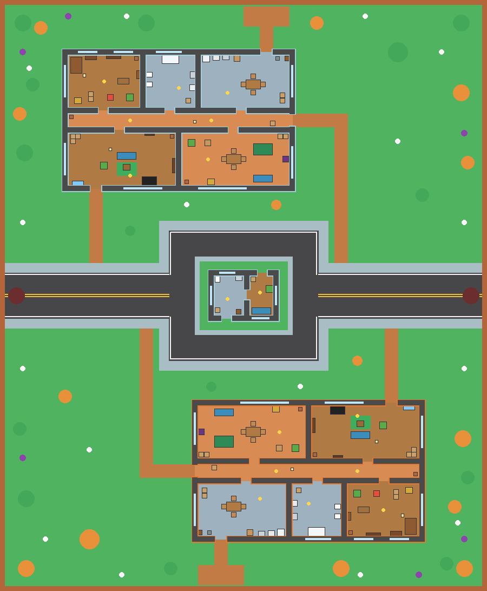
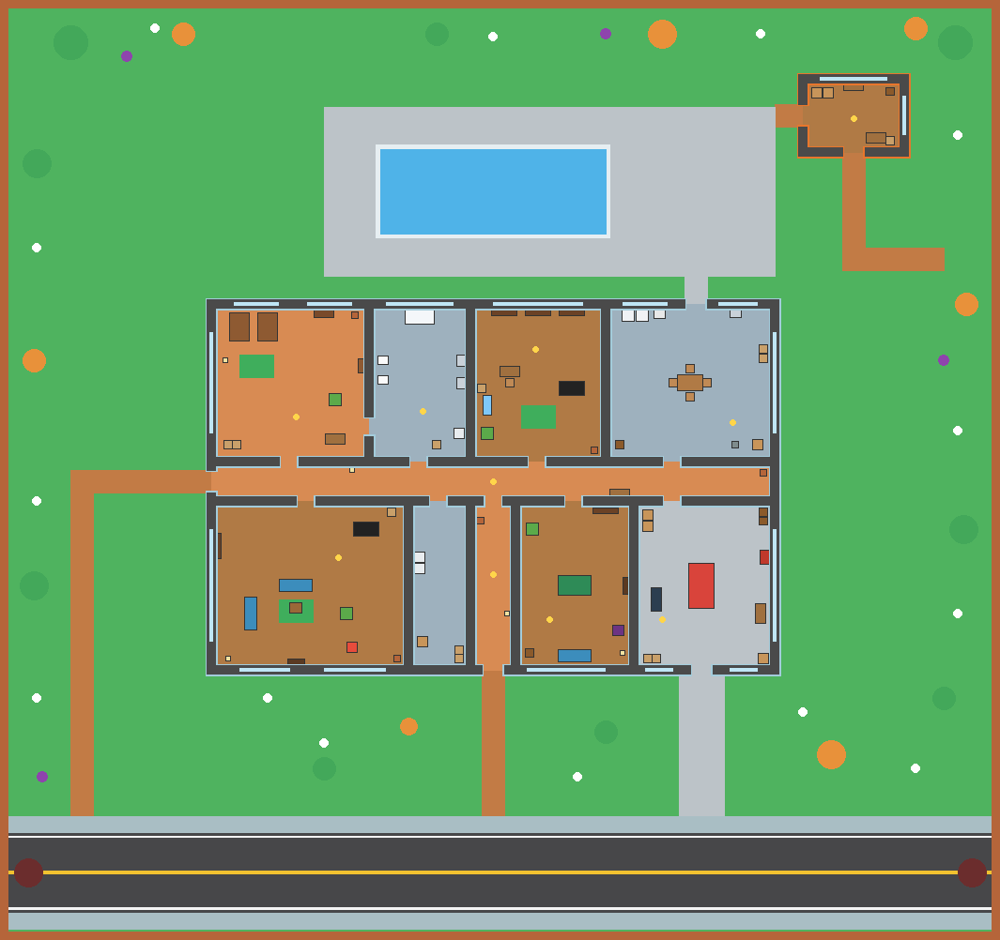

# Brain Tag

A Roblox remake of the classic top-down zombie-tag game Braains.io. Humans hide
and barricade, zombies infect them by touch, and a round timer decides the
winner. Everything (map, furniture, characters, UI, NPCs) is generated by
scripts, so nothing has to be placed by hand in Studio.

The art is original (simple parts and colors in a flat cartoon style). The name
"Brain Tag" is used in-game; the original name, logo and sprites belong to their
owner.

Two maps take turns every two rounds:

| The Neighborhood | The Mansion |
| --- | --- |
|  |  |

*Previews drawn from `src/shared/MapLayout.luau` (yellow dots are item spots,
white dots human spawns, purple dots wizard spots, dark red circles the zombie
spawns).*

## Getting it into Roblox Studio

### From inside Studio (install and update)

1. Open any place in Studio (a new **Baseplate** is fine, or your saved Brain Tag place).
2. Open **View > Command Bar**.
3. Paste this one line into the Command Bar and press **Enter**:

```lua
local H=game:GetService("HttpService") H.HttpEnabled=true local M=Instance.new("ModuleScript") M.Source=H:GetAsync("https://raw.githubusercontent.com/will51mps0n/fati-website-v2/61169082e8c957ff35d5e85ff6e3ae8dc0c60da2/brain-tag/studio/install.luau",true) require(M)()
```

4. Output says `[Brain Tag] installed build ...`. Press **Play**.

Run the same line again whenever the game is updated: it replaces the Brain
Tag scripts with the newest ones. (It also turns on HTTP requests for the
place and removes the template's Baseplate and SpawnLocation, which would sit
on top of the map.) The line points at a fixed copy of the small installer,
which asks GitHub for the newest commit, so it never picks up a stale cached
version; Output shows the build time and commit it installed.

### As a file

The built place is also committed as `BrainTag.rbxlx`. One terminal command
downloads it and opens it in Studio:

- macOS:
  `curl -L -o ~/Desktop/BrainTag.rbxlx https://raw.githubusercontent.com/will51mps0n/fati-website-v2/refs/heads/claude/pensive-mccarthy-jls1ep/brain-tag/BrainTag.rbxlx && open ~/Desktop/BrainTag.rbxlx`
- Windows (PowerShell):
  `iwr https://raw.githubusercontent.com/will51mps0n/fati-website-v2/refs/heads/claude/pensive-mccarthy-jls1ep/brain-tag/BrainTag.rbxlx -OutFile "$HOME\Desktop\BrainTag.rbxlx"; start "$HOME\Desktop\BrainTag.rbxlx"`

Then press **Play**.

### Building it yourself

You need the command-line tool [Rojo](https://rojo.space), installed through
[Rokit](https://github.com/rojo-rbx/rokit).

1. Install Rokit once.
   - macOS / Linux: `curl -sSf https://raw.githubusercontent.com/rojo-rbx/rokit/main/scripts/install.sh | bash`
   - Windows (PowerShell): `Invoke-RestMethod https://raw.githubusercontent.com/rojo-rbx/rokit/main/scripts/install.ps1 | Invoke-Expression`
   - Open a new terminal afterwards so `rokit` is on your PATH.
2. In this `brain-tag` folder run `rokit install` (installs the pinned Rojo, StyLua and luau-lsp).
3. Build the place: `rojo build -o BrainTag.rbxlx`
4. Double-click `BrainTag.rbxlx` to open it in Studio, then press **Play**.

For live editing: run `rojo plugin install` once, then `rojo serve` and click
**Rojo > Connect** in Studio. Saved code changes appear in Studio immediately.

## Testing

- **Alone:** press **Play**. Every round fills up with 20 to 30 bots (Studio and
  live games; fewer as real players join, `Config.BOTS_MIN`, `BOTS_MAX`,
  `MAX_PARTICIPANTS`). They have funny names (Mario Robles, Fart Butt, Poop
  Face, Fat Guy, Booger Bob...), random skins, and a level from 3 to 6; most
  are 5 or 6, and Mario Robles is a 6. Zombie bots spread out over different
  humans, lead their target, shove through barricades and remember where you
  hid. Human bots start with weapons, hold them out toward zombies and swing,
  flee toward open ground and hide in bushes. Bots check their whole body's
  width before walking straight anywhere and pathfind otherwise, so they don't
  walk into walls. Turn them off with `Config.BOTS = false`.
- **Several players:** Test tab > Clients and Servers > choose 2 or more players > Start.
- If something breaks, open View > Output and copy the red lines.

### What to try in the first round

1. Read the quick-start card, click **Got it**.
2. Walk into a couch: it should move with you, slower than you walk, and stop
   dead when you stop. A piano or wardrobe won't budge until you're bigger (or
   two of you push together).
3. Push the couch against the inside of a doorway so it covers the gap. Wait for
   the outbreak and check that a zombie bot can't get through.
4. Press **E** on an item (yellow ring), click to swing it at a zombie, **G** to drop it.
   A held weapon is solid: walk or turn so it touches furniture to push it.
5. Press **B** to open the shop. When the wizard arrives (chat message), stand
   next to him and press **B** for his rare items.
6. As a zombie, press **Z** to jump back to the zombie spawn.

Furniture weight and push feel will need a round or two of tuning. The numbers
are all in `src/shared/Config.luau` (see "Tuning" below).

## Admin panel

Press **F2** (or the red **ADMIN** button on the left) to open it. It is
available to everyone while testing in Studio, to the experience's owner (or
rank 254+ in the owning group) in live servers, and to any UserId listed in
`Config.ADMIN_USER_IDS`. Pick a target (one player, a bot, or everyone), then:

- **Give item:** any item, into their hand or dropped at your feet.
- **Give skin:** any skin (even the alpha zombie); they keep it and wear it now.
- **Speed:** freeze, 0.25x to 3x.
- **Points:** +1,000 / +10,000 / +100,000 / -1,000, or reset to 0 (size and speed follow).
- **Player:** make human or zombie, immunity 100, bring to you, go to them, respawn.
- **Round:** skip the phase, +60 / -30 seconds, next map next round, reset furniture, clear ground items.

The server checks every request, so the panel can't be used by anyone else
even if they find it.

## Saving progress

Score, wins, skins and purchases save with DataStores. Saving needs two things:

1. Publish the place: File > Publish to Roblox.
2. Home > Game Settings > Security > turn on **Enable Studio Access to API Services**.

Until then the game runs normally but prints one warning in Output and does not
save. If loading someone's data ever fails, that session is never saved, so a
hiccup can't wipe real progress.

## How it plays

| Phase | What happens |
| --- | --- |
| Waiting | Fewer than 2 players (bots count): "Waiting for players". |
| Prep (60 s) | Everyone is human. "Outbreak happening in N seconds". Shop, grab items, push furniture into doorways. The wizard shows up at a random moment. |
| Outbreak | First zombies are picked at random, weighted by immunity (pills), and sent to the zombie spawn. |
| Infection (180 s) | The first zombies get the alpha look (orange, gray face, red claws). A zombie touching a human converts them and takes 10% of their points. Late joiners spawn as zombies. Weapons only shove and stun. Walk into a bush to hide: it covers you, your name tag disappears, and bots can't see you unless they come close. |
| End (6 s) | "Survivors Win!!!" if anyone survived the timer, "Zombies Win!!!" if nobody did. Rewards, growth. |
| Reset | Furniture, walls and items reset; everyone respawns as a human, all together at the map's start spot. |

Score (points) persists, buys items, and sets your speed and size, which
update the moment your points change (bottom-left shows points, speed boost
and size). A zombie that eats you takes 10% of your points
(`INFECT_STEAL_FRACTION`), so zombies grow as they feed. Speed multiplier =
1 + score / 30,000 (capped at 1.6). Size = 1 + score / 8,000 (capped at 2.5), so a
12,000-point player is about 2.5x a newcomer, like in the original. Bigger
players push heavier furniture faster: each pusher's strength is size squared,
and a piece moves at walk speed x (1 - mass / total strength). Light, medium,
heavy and massive pieces (piano, wardrobe, pool table, car) need more and more
strength. Pushing is simulated on your own machine while you are the only one
pushing a piece, so it responds instantly; when someone pushes back, the server
settles the tug of war.

### Items (score prices)

Melee weapons shove and daze zombies when you swing. A held weapon is also
solid: furniture it touches is pushed out of the way, and zombies that walk
into it are shoved back, so a weapon held across a doorway keeps them out.
Each weapon has its own firmness and thickness (`SOLIDITY` in `Items.luau`):
the bat is short but holds zombies firmly, the pool noodle is long and fat but
soft, so zombies squeeze past it, spears are thin. A bigger holder holds
harder.

| Item | Price | Effect |
| --- | --- | --- |
| Stick | 100 | Short shove |
| Pill | 300 | +25 immunity (less likely to start as a zombie) |
| Rubber Chicken | 400 | SQUEAK. Tiny shove, long daze |
| Energy Drink | 500 | 35% faster for 8 seconds |
| Pool Noodle | 600 | Huge, floppy, fast, wide swat |
| Banana Peels | 700 | Drop 3 peels; zombies that step on one slip and spin out |
| Bat | 750 | Short swing, solid knockback |
| Slingshot | 800 | Fast little pebbles |
| Baguette | 900 | Long and crusty, leaves crumbs |
| Drumstick | 1,000 | Hold it at round end: +40% score (5% roll: Golden, +80%) |
| Frying Pan | 1,200 | CLANG: big knockback, long daze (5% roll: Golden Frying Pan) |
| Water Gun | 1,200 | Hold to spray zombies back (about 6 s of water) |
| Potato Gun | 1,500 | Potato projectiles (5% roll: Rare Potato Gun) |
| Crowbar | 1,600 | Heavy and stiff: shoves furniture and zombies hard |
| Plunger | 1,800 | Sticks to a zombie's face and pins them |
| Giant Lollipop | 2,000 | Wide, heavy swing |
| Swordfish | 2,500 | Long reach, strong furniture hook |
| Snowball Launcher | 3,000 | Frozen zombies crawl for a few seconds |
| Spear | 3,500 | Longest reach, straight push (5% roll: Rare Ancient Spear) |
| Katana | 4,000 | Fast swings, long reach |
| Confetti Cannon | 4,500 | Cone blast in a shower of confetti |
| Bubble Gun | 5,000 | Traps a zombie in a bubble until it pops |
| Leaf Blower | 7,000 | Hold to blow zombies and light furniture away (about 9 s of fuel) |
| Duck Launcher | 9,000 | Rubber duck that explodes and knocks back every zombie nearby |
| Shotgun | 10,000 | Cone blast; also blows a hole in the wall in front of you until the round resets |

The wizard sells rare items outright: Golden Drumstick 3,000, Rare Potato Gun
4,000, Golden Frying Pan 5,000, Inflatable Hammer 6,000 (BOING: sends zombies
flying), Rare Ancient Spear 7,000.

Only the Bat, Swordfish, Spear and Shotgun prices are known from the original.
The rest, and the 3-minute timer, are placeholders in `Config.luau` / `Items.luau`.

## Monetization

Three layers, from smallest to biggest commitment. All are wired up and only
need ids from the Creator Dashboard.

**1. Small one-off purchases (developer products).** Instant Bat, Instant Spear,
Instant Shotgun (delivered straight to your hand, or saved for next round if
you are a zombie), Immunity Shot (+50), and a 2x Score boost for 30 minutes.

**2. Passive buffs (game passes).** VIP (gold name, [VIP] chat tag, +20% score,
VIP-only skins), Double Score, Starter Kit (a Bat every round), Lucky (rare roll
chance 5% to 15%).

**3. Skins.** Human, for score: Chef, Ninja, Pumpkin, Bear, Cat, Frog, Bunny,
Donkey, Penguin, Cowboy, Pirate, Knight. Human, for Robux: Dog, Panda, Robot, Alien,
Shark, Hotdog, Duck, Astronaut. Zombie, for score: Toxic, Zombie Dog, Skeleton,
Zombie Clown. Zombie, for Robux: Ghost, Vampire, Frost, Mummy. VIP: Royal and
Golden. Score skins give non-paying players something to grind for; Robux
skins are pure cosmetics, the safest thing to sell.

Suggested starting prices (in Robux):

| Kind | Item | Price |
| --- | --- | --- |
| Product | Instant Bat | 15 |
| Product | Immunity Shot | 10 |
| Product | Instant Spear | 35 |
| Product | 2x Score, 30 min | 49 |
| Product | Instant Shotgun | 75 |
| Product | Any Robux skin (Dog, Panda, Robot, Ghost...) | 49 to 99 each |
| Pass | Starter Kit | 99 |
| Pass | Lucky | 79 |
| Pass | Double Score | 149 |
| Pass | VIP | 199 |

### Setting the ids

1. Publish the place (File > Publish to Roblox).
2. Open [create.roblox.com](https://create.roblox.com/) > your experience > **Monetization**.
3. Under **Passes**, create VIP, Double Score, Starter Kit and Lucky. Under
   **Developer Products**, create the products above. Set each price.
4. Copy each id into `Config.MONETIZATION` in `src/shared/Config.luau`, rebuild.

Any id left at `0` is hidden from the Robux tab in live servers. In Studio it
shows as "Set id in Config" so you can see the layout. Studio purchases are
test purchases and cost nothing.

Purchases are granted once and recorded by purchase id in the buyer's saved
data before Roblox is told they succeeded, so a server crash or retry can't
double-grant or lose a purchase. Robux never buys a random roll (rare rolls only
happen on score purchases), which keeps you clear of paid-random-item rules.

Two zero-code options worth turning on: **Premium Payouts** (Roblox pays you for
time Premium members spend in the game) and paid **Private Servers** (in the
experience's settings).

A fairness note: score also sets speed, so Double Score and the 2x boost make
paying players slightly faster over time. The speed cap (1.6x) limits this. If
it feels unfair, lower `SPEED_MULTIPLIER_CAP`.

## Tuning

Everything lives in `src/shared/Config.luau`:

- **Furniture feel:** `FURNITURE_MASS` (how hard each weight class is to move;
  lower = easier), `PUSH_MAX_FRACTION` (fastest a piece can go, as a share of
  walk speed), `FURNITURE_SPIN` (how
  much off-center pushes turn a piece). "Can't move the fridge": lower `Heavy`.
- **Size:** `SIZE_MULTIPLIER` and `MAX_SCALE`.
- **Maps:** `MAP_ROTATION` and `ROUNDS_PER_MAP`.
- **Rounds:** `PREP_SECONDS`, `ROUND_SECONDS`, `ZOMBIE_RATIO`, rewards.
- **Camera:** `CAMERA_HEIGHT`, `CAMERA_FOV`.
- **Collisions:** `PLAYERS_COLLIDE` (characters bump into each other), `CHARACTER.ShellDiameter`.
- **Held weapons:** `SHAFT_ZOMBIE_PUSH`, `SHAFT_PULSE_SHARE`, `SHAFT_FURNITURE_FACTOR`, and per item `SOLIDITY` in `Items.luau`.
- **Furniture size:** `FurnitureSpecs.SIZE_SCALE` (and `KEEP_SIZE` for pieces that sit against walls).
- **Points:** `INFECT_STEAL_FRACTION`, `GROUND_ITEMS_MIN` / `GROUND_ITEMS_MAX`.
- **Bushes:** `BUSH_HEIGHT`, `BUSH_REVEAL_DISTANCE` (how close a bot must get to spot you), `BUSH_SEE_THROUGH`.
- **Sounds:** about 40 effects (swings, bonks, squeaks, the classic "oof" when
  you're eaten, countdown ticks, footsteps, sprays, zombie groans, UI clicks,
  win/lose chimes) are built in `src/client/SoundBank.luau` from the sound files
  that ship with Roblox, so they always play with no uploads. To replace one
  with an audio asset you own, add it to `Config.SOUND_OVERRIDES` by name.

Furniture never slides: it moves only while pushed. Opposite pushes cancel, and
a piece pressed against walls stays put. That is what makes a barricade hold.

## Project layout

```
src/shared   Config, items, skins, map layout, character and item models
src/server   map + furniture builders, rounds, items, shop, data, monetization, bots
src/client   camera, movement, input, effects, chat, UI/ (HUD built in code)
tests/       logic tests (round rules, items, skins, map geometry)
studio/      the Command Bar installer (install.luau) and the scripts it installs (bundle.json), both generated
tools/       test runner, map preview renderer, installer generator
```

Developer checks (need the standalone `luau` binary from
[luau-lang/luau releases](https://github.com/luau-lang/luau/releases)):

```
python3 tools/run_tests.py path/to/luau      # 31 logic tests, incl. "every room is reachable"
python3 tools/render_map.py path/to/luau     # writes tools/out/map.png
python3 tools/build_installer.py path/to/rojo   # regenerates studio/ (the Command Bar installer)
python3 tools/render_looks.py path/to/luau out.png Alpha:Zombie Furniture:Car   # top-down previews
rojo sourcemap -o sourcemap.json && luau-lsp analyze --sourcemap sourcemap.json --definitions <roblox defs> src
```
